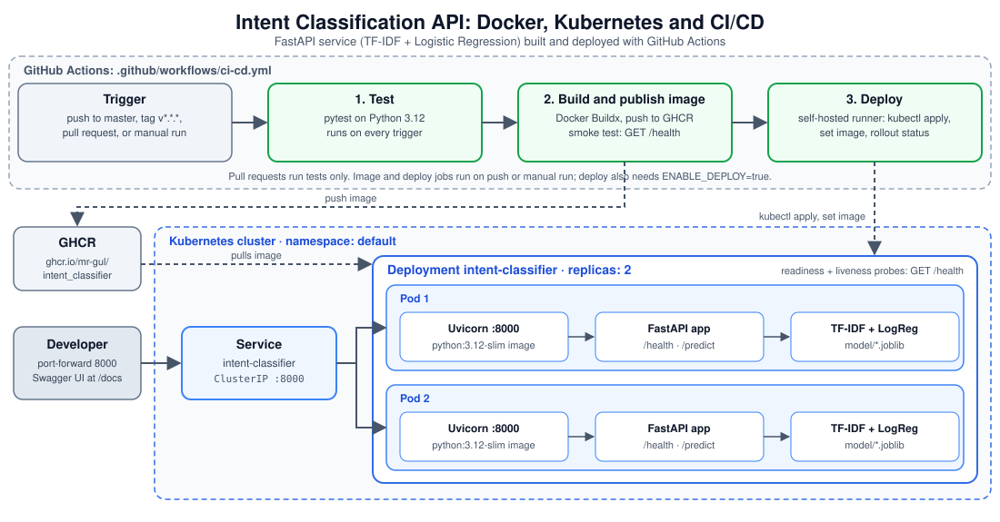

# Intent Classifier API

A FastAPI service that classifies user text into intents using a pre-trained scikit-learn model.
## Architecture

<p align="center">
  <picture>
    <source media="(prefers-color-scheme: dark)" srcset="docs/architecture-diagram-master-dark.svg">
    
  </picture>
</p>

## Features

- REST API for intent prediction (`POST /predict`)
- Health and root endpoints (`/health`, `/`)
- Pre-trained model + TF-IDF vectorizer loaded from `model/`
- Containerized runtime via Docker
- Kubernetes manifests for deployment (`k8s/`)
- CI/CD workflow for tests, image publish, and optional Kubernetes deploy

## Project Structure

```text
app/                # FastAPI app, schema, and prediction logic
model/              # Serialized model artifacts (.joblib)
tests/              # API tests (pytest)
k8s/                # Kubernetes Deployment and Service manifests
Dockerfile          # Container build/runtime definition
requirements.txt    # Python dependencies
.github/workflows/ci-cd.yml
```

## Prerequisites

- Python 3.12
- pip
- (Optional) Docker
- (Optional) kubectl + Kubernetes cluster

## Run Locally

From the repository root:

```bash
python -m venv .venv && source .venv/bin/activate && python -m pip install --upgrade pip && python -m pip install -r requirements.txt && uvicorn app.main:app --host 0.0.0.0 --port 8000
```

API will be available at `http://127.0.0.1:8000`.

## Run Tests

```bash
python -m pytest
```

## API Endpoints

| Method | Path       | Description |
|---|---|---|
| GET | `/` | Service info message |
| GET | `/health` | Health check |
| POST | `/predict` | Predict intent from input text |

### Example Request

```bash
curl -X POST "http://127.0.0.1:8000/predict" \
  -H "Content-Type: application/json" \
  -d '{"text":"I forgot my password"}'
```

Example response shape:

```json
{
  "text": "I forgot my password",
  "intent": "password_reset",
  "confidence": 0.9876
}
```

## Test the API via Browser

You can test the Intent Classifier API through the interactive FastAPI documentation interface without using `curl` or writing shell commands to send requests.

###  Start the Kubernetes Port Forward

Ensure your Kubernetes cluster is running and the application pods are healthy.

Run the following command in your terminal:

```bash
kubectl port-forward service/intent-classifier 8000:8000
```

Keep the terminal open while testing the API. This forwards local port `8000` to the Kubernetes Service.

###  Open the API Documentation

Open the following URL in your web browser:

**http://127.0.0.1:8000/docs**

The FastAPI Swagger UI will display the available API endpoints.

### Test the Prediction Endpoint

1. Locate the `POST /predict` endpoint.
2. Click to expand it.
3. Click **Try it out**.
4. Enter the following JSON in the request body:

   ```json
   {
     "text": "I forgot my password"
   }
   ```

5. Click **Execute**.

### View the Prediction

The API will process the input text and display the HTTP response, including the model's prediction.

You can try other inputs, for example:

```json
{
  "text": "Where can I track my order?"
}
```

```json
{
  "text": "I want to cancel my subscription"
}
```

### Notes

- The Kubernetes cluster and application pods must be running.
- The port-forward command must remain active while testing.
- Access through `127.0.0.1` is local to the machine running the port forward. Other users cannot access your local URL directly.
- Press `Ctrl+C` in the port-forward terminal to stop forwarding. This does not delete or stop the Kubernetes deployment.

## Configuration / Environment Variables

The application code currently does not require runtime environment variables for startup.

CI/CD workflow variables (from `.github/workflows/ci-cd.yml`):

- `PYTHON_VERSION`
- `IMAGE_NAME`
- `IMAGE_TAG` (smoke test step)
- `IMAGE` (deploy step)
- `ENABLE_DEPLOY` repository variable gates the deploy job

## Docker

Build and run:

```bash
docker build -t intent-classifier:local .
docker run --rm -p 8000:8000 intent-classifier:local
```

## Kubernetes

Manifests are provided in `k8s/` for:

- `Deployment` (`k8s/deployment.yaml`)
- `Service` (`k8s/service.yaml`)

Apply them:

```bash
kubectl apply -f k8s/
```

To update the deployment image (pattern used in CI):

```bash
kubectl -n default set image deployment/intent-classifier intent-classifier=<your-image>
kubectl -n default rollout status deployment/intent-classifier --timeout=180s
```

## GitHub Actions Workflow

`.github/workflows/ci-cd.yml` defines:

1. **test**: installs dependencies and runs `python -m pytest`
2. **image**: builds and pushes image to GHCR, then smoke-tests `/health`
3. **deploy**: deploys to Kubernetes when deploy conditions are met
