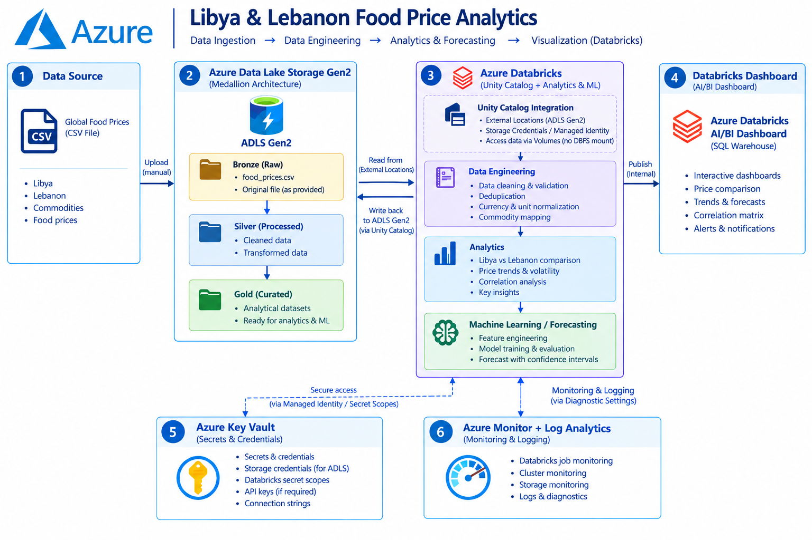

# Intent Classification API

FastAPI service that classifies support messages into 9 intents (TF-IDF + Logistic Regression), deployed on AWS behind an Application Load Balancer with auto scaling.

## Architecture


<p align="center">
  
</p>

## API

| Method | Path       | Purpose                                  |
|--------|------------|------------------------------------------|
| GET    | `/health`  | Health check used by the target group    |
| POST   | `/predict` | Returns `intent` and `confidence`        |

```bash
curl -X POST "http://<alb-dns-name>/predict" \
  -H "Content-Type: application/json" \
  -d '{"text": "I forgot my password"}'
```

## Deployment

1. **Launch Template:** Ubuntu AMI, `t3.small`, security group, and `userdata.sh` as user data (installs the app and Nginx, starts the `intent-classifier` service).
2. **Target Group:** instance type, HTTP on port 80, health check path `/health`.
3. **Application Load Balancer:** internet-facing, two public subnets, HTTP:80 forwarded to the target group.
4. **Auto Scaling Group:** launch template and target group attached; min 1, desired 1, max 3.
5. **Scaling policy:** target tracking on ALB requests per target, target value 100.
6. **Security groups:** the instance security group must allow HTTP from the ALB security group.

## Updating the application

1. Create a new Launch Template version.
2. Point the ASG at that version.
3. Start an instance refresh and monitor instance health.

Do not run load tests during an instance refresh.

## Load testing

```bash
sudo apt-get update && sudo apt-get install -y apache2-utils
echo '{"text": "I forgot my password"}' > predict.json
export ALB="http://<your-alb-dns-name>"

# Five minutes, 500 concurrent requests
ab -n 9999999 -c 500 -t 300 -p predict.json -T application/json "$ALB/predict"
```

Start with lower concurrency if the load generator or AWS resources become overloaded. While testing, watch ASG activity, CloudWatch metrics, target group health, and EC2 CPU. A successful scale-out adds healthy instances that receive traffic.

## Troubleshooting

| Issue                    | Action                                                       |
|--------------------------|--------------------------------------------------------------|
| HTTP 503                 | Check target health, app status, and health-check settings   |
| Connection refused       | Verify Nginx, the app service, and security groups           |
| No scale-out             | Check CloudWatch metrics, scaling policy, and ASG activity   |
| New instances unhealthy  | Inspect user data logs and target health reason codes        |
| High request failures    | Reduce concurrency; inspect app and instance resources       |

```bash
sudo systemctl status intent-classifier
sudo systemctl status nginx
sudo journalctl -u intent-classifier -n 100 --no-pager
sudo tail -n 100 /var/log/cloud-init-output.log
curl -i http://127.0.0.1:8000/health
```

## Limitations

- Maximum capacity is three instances.
- Scale-out takes time: instance launch, app start-up, and health checks.
- Apache Benchmark may become the bottleneck before the service does.
- EC2, ALB, and related AWS resources incur charges.
